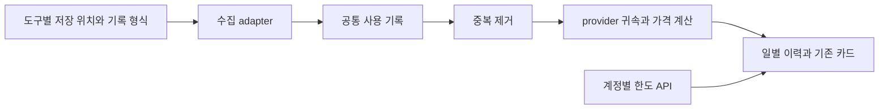

# 사용량 수집

## 목적과 범위

계정·구독 한도를 조회하는 provider와 사용 기록을 만드는 CLI·harness·앱을 분리.
도구 추가 시 인증·카드·가격 계산을 복제하지 않고 수집 adapter 추가로 확장.

한도·잔액 조회 대상은 기존 12개 provider 유지.
Claude, Codex, Cursor, Antigravity, GitHub Copilot, Devin, Grok, Kimi, Kiro, OpenCode, OpenRouter, Z.ai.
Grok Bot은 기존 Grok·Cursor의 지원 범위 보완 항목.
별도 provider 추가 대상은 없음.

사용 기록 수집의 전체 대상은 다음 23개.
native 수집기와 공통 adapter를 함께 사용하며, 아래 세부 범위와 제한 적용.

| 분류 | 대상 |
|---|---|
| 기존 연계 도구 10개 | Claude Code, Codex CLI, Cursor IDE, Antigravity, GitHub Copilot CLI, Devin CLI, Grok Build, Kimi CLI, Kiro, OpenCode |
| Pi 계열 2개 | Pi, Oh My Pi(OMP) |
| 추가 CLI 2개 | Gemini CLI, Qwen CLI |
| 범용 harness 3개 | OpenClaw, Hermes Agent, DeepSeek Harness |
| IDE·관련 CLI 3개 | Kilo Code, Kilo CLI, Junie |
| 제품군 확장 3개 | Devin Desktop, Antigravity CLI, Antigravity IDE Extension |

Claude Desktop Code·Cowork의 사용량 기록, Kimi Code·Work, Kiro CLI·IDE도 해당 제품군의 세부 수집 범위.
일반 채팅처럼 사용량 기록이 없는 경로는 정확한 토큰 수집 대상으로 간주하지 않음.
주 세션·fork·하위 에이전트의 기록은 같은 수집 규칙 적용.
별도 합계와 원본 호출이 함께 기록된 도구 결과는 중복 합산하지 않음.

Claude Code·Codex CLI·Grok·Antigravity·Copilot·OpenCode의 기존 원장은 각 native 수집기에서 계속 처리.
Devin·Kimi·Kiro는 기존 native 원장과 확인된 보충 기록을 병합.
Cursor·OpenRouter의 계정 전체 통계와 Z.ai 할당량에는 로컬 도구 기록을 자동 가산하지 않음.

MiniMax·MiniMax Token Plan·Sakana Fugu는 별도 provider 수집·자동 탐색 대상에서 제외.
지원 도구에 기록된 미등록 provider의 사용량은 공통 수집 결과에 보존하지만 provider 카드에는 반영하지 않음.

## 역할 분리

- 수집 adapter: 경로 탐색·형식 해석·외부 숫자 검증 담당.
- 공통 기록: 도구, 원본 provider, 요청·응답 모델, 세션·부모 세션·응답 식별자, 시각, 토큰, 기록된 비용 보존.
  요청별 기록과 세션·모델별 합계, 측정 토큰과 추정 토큰, 기기 로컬과 계정 전체 범위도 구분.
- 수집 모듈: 파일 탐색·증분 캐시·읽기 실패·취소·중복 제거 담당.
- 귀속·가격 모듈: 기록된 provider를 표시 대상에 연결하고 기존 가격 엔진 호출.
- provider: 인증·원격 한도 조회·스냅샷 생성 담당.
- 표시 모듈: 기존 `LogUsageScan`·`ProviderUsageHistory`·`SpendTileMapper` 재사용.

새 저장 형식은 동일한 공통 기록을 반환하는 adapter로 추가.
같은 JSONL 형식을 사용하는 도구는 파서를 공유하고 경로·지원 기록 유형만 분리.
공통 수집 adapter는 선언 순서대로 실행하고, 기본 JSONL 파일 읽기·파싱도 한 번에 하나씩 처리.
공통 모듈에 도구별 JSON 필드나 모델명 추측 규칙을 추가하지 않음.
별도 복제 DB나 백그라운드 업로드 없음.
파일 수집과 읽기 전용 SQLite 수집 기반 제공.
Pi·OMP는 JSONL 세션을 읽고 OpenClaw·Hermes는 SQLite 원장도 수집.
OpenClaw·DeepSeek·Codex는 일반 원장과 Zstandard 압축 원장을 함께 지원.
압축 원장용 기반은 앱에 포함한 공식 `libzstd` 1.5.7 사용.
macOS Compression은 해당 형식을 지원하지 않음.
사용자에게 별도 압축 명령 설치를 요구하지 않음.

## 저장 위치

Pi는 `PI_CODING_AGENT_SESSION_DIR`을 우선 사용.
상대 세션 경로는 Pi의 실행 디렉터리를 알 수 없어 오류로 처리하며 절대 경로와 홈 경로 지원.
그 외에는 `PI_CODING_AGENT_DIR` 또는 기본 `~/.pi/agent` 아래의 전역 `settings.json`에서 `sessionDir` 확인.
설정이 없으면 해당 agent 디렉터리 아래 `sessions` 사용.
전역 `sessionDir`은 절대 경로와 `~` 경로만 지원.
실행 작업 디렉터리가 필요한 프로젝트 설정이나 상대 `sessionDir`, `PI_CODING_AGENT_DIR`은 추정하지 않음.
설정을 읽거나 해석하지 못하면 다른 기본 원장을 대신 읽지 않고 수집 오류로 구분.
매 수집에서 전역 설정을 다시 읽어 파일 수정과 `sessionDir` 변경 반영.

OMP 기본 저장 위치는 `~/.omp/agent/sessions`.
`OMP_PROFILE` 또는 이전 `PI_PROFILE`로 선택한 프로필과 `PI_CONFIG_DIR`을 반영.
명시적 기본 프로필은 이전 프로필에서 상속한 agent 경로와 구분.
해당 OMP 데이터 디렉터리가 있으면 `XDG_DATA_HOME`의 세션 경로를 우선 사용.
적용 대상인 `XDG_DATA_HOME`과 `PI_CODING_AGENT_DIR`이 상대 경로면 OMP 세션 경로를 확인할 수 없는 상태로 표시.
매 수집 시 저장 위치를 다시 확인하여 실행 중 생성된 XDG 데이터 디렉터리도 반영.
유효하지 않은 프로필은 다른 프로필로 대체하지 않고 수집 오류로 구분.

Gemini CLI는 `GEMINI_CLI_HOME` 또는 사용자 홈의 `.gemini/tmp`와 `.cache/.gemini/tmp` 아래 `chats` JSON·JSONL 기록 조회.
Qwen CLI는 `QWEN_RUNTIME_DIR`, `QWEN_HOME`, 기본 `~/.qwen` 순서로 루트 선택.
선택한 루트의 `projects` 아래 `chats` JSONL과 `resources`의 관리형 원장 리소스 조회.
세 환경 변수의 앞뒤 공백은 제거하며, 빈 값·공백만 있는 값은 미설정으로 처리.
`~`와 `~/...`는 사용자 홈으로 확장하며, 다른 상대 경로는 egasu 프로세스의 현재 작업 디렉터리 기준.
`~user`는 사용자 홈 표기로 확장하지 않고 같은 이름의 상대 경로로 처리.
비어 있지 않은 설정 경로를 선택한 뒤에는 해당 경로가 없어도 다음 설정이나 기본 경로로 대체하지 않음.

OpenClaw는 `OPENCLAW_HOME` 또는 사용자 홈 아래의 상태 폴더를 사용하고 `OPENCLAW_STATE_DIR`이 있으면 그 경로를 우선 사용.
선택한 프로필 또는 기본 `.openclaw`·이전 이름의 agent 아래 `sessions` 원장과 `openclaw-agent.sqlite` 조회.
Hermes Agent는 `HERMES_HOME` 또는 기본 `~/.hermes`의 `state.db`와 프로필별 `state.db` 조회.
DeepSeek Harness는 `DSH_HOME` 또는 기본 `~/.dsh` 아래 `sessions`의 최신 세대 원장 조회.

## 보존 규칙

### 원본 기록과 귀속

카드로 매핑되지 않는 provider도 정상 기록으로 보존.
모델 제조사만 보고 결제 provider나 계정을 추측하지 않음.
예를 들어 `openai`와 `openai-codex`, `openrouter`와 모델 제조사는 서로 다른 귀속.
현재 계정의 인증·설정으로 과거 호출의 계정·서비스 티어를 채우지 않음.
Pi·OMP에서 계정 신원을 확인할 수 없는 기록은 계정별 스냅샷 카드에 합산하지 않음.
기존 Claude 다중 로그인 시 공유 harness 기록을 제외하는 규칙 유지.
Cursor처럼 계정 전체 내보내기를 사용하는 provider에는 같은 호출일 수 있는 로컬 기록을 자동 가산하지 않음.

### 중복과 세션

각 파일 수집기는 실제 경로 기준으로 한 번만 수집.
같은 경로를 가리키는 설정·기본 경로·심볼릭 링크의 중복 방지.
Pi와 OMP 경로가 같으면 한 번만 읽고 기록에 있는 OMP 전용 토큰 필드도 보존.
명시한 Pi 세션·agent 경로에서도 OMP 전용 필드가 있으면 해당 형식으로 해석.
두 형식의 공통 필드만 있는 기록은 생성 도구를 단정할 수 없어 기존 Pi 시각 우선순위 유지.
응답 식별자가 있으면 provider와 함께 중복 판단.
그 외에는 기록 유형·항목 ID·시각·provider와 세션 관계로 사본 구분.
서로 독립된 세션의 짧은 항목 ID만으로 중복 제거하지 않음.
fork에 복사된 과거 기록은 원본과 한 번만 집계하고 이후 새 호출은 유지.
부모 세션이 파일 경로이면 실제 경로로 정규화하여 심볼릭 링크 별칭도 같은 원장으로 처리.
동일 호출의 사본 중 정상 기록과 더 완전한 사용량을 우선.
정상 사본의 비용 출처가 다르면 제공자가 보고한 비용을 추정액보다 우선하며 보고된 0도 유지.
같은 세션 계보에서 모든 식별 필드가 같은 독립 기록과 복사본은 현재 정보만으로 구분 불가.
시각·모델이 없는 압축·요약·도구 사용량은 주변 메시지에서 추측하지 않고 불완전 기록으로 보존.

### 토큰과 비용

공통 기록의 토큰은 가격 유무와 무관하게 보존.
조회 시각보다 미래에 시작한 기록은 해당 조회의 토큰·비용 합산에서 제외.
음수·소수 토큰·오버플로·유한하지 않은 비용은 파싱 단계에서 오류 표시.
정상적인 비용 0과 비용 부재를 원본 기록에서 구분.
Pi의 `cost.totalFromProvider=true`는 제공자가 보고한 비용으로 구분하며 0도 유지.
Pi에서 해당 플래그가 없는 비용과 OMP의 단가표 비용은 추정액으로 구분.
OMP는 `reasoningTokens`·`cttl`과 orchestration 토큰을 원본 의미에 맞게 보존.
추정 비용이 양수이면 해당 값을 우선하고, 0이거나 없으면 기존 모델 가격 엔진 사용.
Codex 귀속은 Codex의 요청별 가격 규칙 재사용.
OMP의 Anthropic priority 기록은 지원 모델의 Fast 요율로 추정하며 priority 기능이 비활성화된 재시도는 표준 요율 적용.
세션 합계에 요청별 장문 요금을 적용하지 않음.

Pi·OMP 기록의 가격을 구하지 못해도 Tokens·Usage Trend·모델별 토큰은 유지.
가격이 불완전한 날짜·기간은 총 Cost와 Cost/MTok 생략.
확인된 일부 비용을 전체 토큰으로 나누지 않음.
가격을 계산할 수 있는 모델의 개별 비용은 모델 내역에 유지.
가격 미지원 건수는 비용이 없고 토큰이 양수인 기록에 한정.
제공자가 보고한 비용이 있으면 가격 미지원 표시만으로 해당 비용을 제외하지 않음.
이 규칙은 native·harness·공유 도구 이력 병합과 iCloud 병합에서도 유지.
native 파서별 원본 해석·가격 정책은 각 provider 문서 참조.
Kiro의 크레딧 환산과 추정 토큰, 모델 없는 비용 기록도 별도 의미로 보존.

### 캐시와 실패

기존 증분 JSONL 스캐너와 디스크 캐시 재사용.
캐시에는 정규화된 원본 사용 기록을 저장하고 카드 귀속·가격 결과는 저장하지 않음.
가격 갱신 후 원본 파일 재파싱 없이 재계산 가능.
파서 버전·도구·실제 루트로 캐시 구분.
공통 수집기의 읽기 실패는 진단 로그와 카드 경고로 전달.
잘못된 숫자·메타데이터는 진단 로그에 기록하고 가격 미확정 모델은 원본 집계 정보에 보존.
이런 집계 제약은 카드 경고로 표시하지 않고 정상 사용량은 계속 집계.
가격이 없는 기간의 비용 생략과 마지막 정상 이력 보존 규칙은 카드 경고 여부와 무관하게 적용.
공통 수집기는 읽기 성공한 기록과 실패한 경로를 구분하여 보존.
취소된 공통 수집 결과는 게시하지 않음.
파일 탐색 중에도 취소 확인.
취소로 중단된 파일의 읽기·파싱은 읽기 실패로 기록하지 않음.
정상적으로 읽은 공유 소스에 해당 provider 기록이 없으면 완료된 빈 이력으로 반영.
세션 파일이 모두 삭제된 공유 도구 디렉터리도 탐색에 성공하면 완료된 빈 이력으로 반영.
탐색한 파일이 모두 조회 기간 밖인 경우도 완료된 빈 이력으로 반영.
소스 부재·읽기 실패·취소는 정상적인 빈 이력과 구분.
네이티브 이력의 읽기 실패 탐지와 공유 이력의 화면 반영은 provider별 구현에 따름.
Claude·Codex는 발견한 native 파일의 읽기 실패 수를 공유 이력 병합에도 전달.
정상 기여가 없는 실패 결과는 이전 이력을 빈 값으로 교체하지 않고 읽기 경고로 안내.
취소되거나 전체 수집이 실패한 결과로 마지막 정상 이력을 비우지 않음.
취소 전에 파싱을 완료한 파일의 캐시는 유지하여 다음 조회에서 재사용.
취소 중 처리하던 파일과 미완료 전체 집계는 게시하지 않음.
소스별 부재·성공·부분 실패·전체 실패를 구분하여 다른 provider의 실패가 정상 이력을 지우지 않게 처리.
SQLite는 읽기 전용 조회 사용.
DB 본체의 수정 시각만으로 캐시하지 않으며 WAL의 최신 기록도 같은 읽기 스냅샷에서 조회.
대화 본문·인증 정보는 공통 기록이나 진단 로그에 저장하지 않음.

## Gemini CLI와 Qwen CLI 원장

Gemini CLI의 각 JSON 스냅샷과 JSONL 파일에서 같은 세션·메시지 ID가 여러 번 나오면 마지막 기록 사용.
파일 간에는 같은 세션·항목·시각 등 중복 식별 정보가 일치할 때 완전성, 기록된 비용, 토큰 수 순서로 우선순위 적용.
손상된 JSONL 행은 별도 불완전 기록으로 남기고 정상 행의 사용량 유지.
캐시 읽기 토큰은 입력 토큰의 부분집합으로 처리.

Qwen CLI는 같은 홈·프로젝트 범위에서 응답 UUID와 fork 관계로 복사된 기록 구분.
일반 원장의 마지막 미완성 행은 건너뛰고 앞의 완전한 기록 유지.
사고 토큰이 없는 기록의 양수 총합이 제공된 입력·출력과 일치하지 않으면 불완전 기록으로 처리.
입력·출력 없이 총합만 제공된 기록은 그대로 유지.
관리형 원장은 실행 엔진 메타데이터 뒤의 헤더를 확인하고 commit·리소스 길이·해시 검증.
헤더의 필수 리소스, 선언된 baseTranscriptProof, snapshot manifest의 resources 검증.
리소스는 선언 길이보다 최대 1바이트 더 읽어 길이와 해시 확인.
관리형 원장은 원장 파일이 바뀌지 않아도 외부 리소스를 매번 재검증.
재검증 도중 취소되면 바뀌지 않은 파일의 기존 캐시는 유지하고 현재 집계 결과는 폐기.
일반 원장은 기존 파일 캐시 재사용.
완료되지 않은 마지막 행은 관리형 원장의 확정된 기록으로 취급하지 않음.
commit 해시는 JavaScript의 키 순서·숫자 직렬화 규칙으로 검증.
잘못된 commit이나 리소스는 파일 읽기 실패로 처리.

## OpenClaw·Hermes·DeepSeek 원장

OpenClaw는 JSONL과 SQLite transcript를 함께 읽고 동일 이벤트를 한 번만 반영.
선택한 상태 디렉터리의 `agents`와 이전 단일 에이전트 형식의 최상위 `sessions`에서 이력 수집.
최상위 `sessions`가 외부 디렉터리의 심볼릭 링크여도 조회하며, 링크 대상 변경은 다음 수집부터 반영.
`OPENCLAW_HOME`의 빈 값과 문자열 `undefined`·`null`은 설정 없음으로 처리.
JSONL 파일의 마지막 행이 줄바꿈 없이 잘렸으면 완료된 앞부분을 유지하고 마지막 행은 불완전 기록으로 진단.
잘린 행의 provider·모델은 이전 행에서 추정하지 않으며, 귀속을 확인할 수 없는 진단은 특정 카드에 연결하지 않음.
줄바꿈 없는 마지막 행도 완전한 JSON 객체이면 반영하며, 줄바꿈으로 끝난 손상 행과 SQLite 보관 원장의 손상은 읽기 실패로 처리.
`.zst` 파일은 완전한 압축 프레임을 검증한 뒤 같은 JSONL 규칙을 적용하며, 잘린 압축 프레임은 계속 읽기 실패로 처리.
원본 payload가 cold archive로 이동했으면 보관 목록과 blob·파일·chunk의 길이·해시·순서를 확인한 뒤 복원.
DB 파일이 심볼릭 링크이면 발견한 원본 위치를 기준으로 cold archive 조회.
복원할 수 없는 원본은 불완전 기록으로 남김.
누락된 payload 뒤의 provider·모델은 새 귀속 정보가 확인될 때까지 이전 값에서 이어받지 않음.
DB 행의 세션 식별자와 payload의 세션 header ID가 다르면 읽기 실패로 처리.
파일명 끝이 `.tmp`인 임시 보관 파일은 수집에서 제외하며, 기존 일반·압축 deleted/reset 보관 파일의 허용 범위 유지.
`totalOrigin=provider-billed` 비용의 0과 양수를 제공자 보고액으로 보존.
`usageReport.state=unavailable` 기록은 원본의 측정값과 비용을 공통 기록에 보존하되 합산에서 제외하고 불완전 이력으로 진단.
OpenClaw의 Codex mirror는 전체 요청 원장이 아니므로 native Codex 원장과 중복 합산하지 않음.
기본 Codex 카드만 OpenClaw 전용 Codex 홈을 조회하고 계정별 카드에는 해당 이력을 추가하지 않음.
Codex 조회는 에이전트 목록과 전용 Codex 저장소로 제한하며 OpenClaw transcript·cold archive 트리 전체를 다시 탐색하지 않음.

Hermes Agent는 모델별 세션 누적 기록을 우선하며 세션 총계와 그대로 더하지 않음.
기본·지정 홈의 `state.db`가 심볼릭 링크여도 대상 DB 조회.
매 수집에서 홈과 `state.db` 링크의 현재 대상 확인.
본 호출의 확인 가능한 잔여분과 독립 보조 호출을 구분.
`codex_thread_id`가 확인된 본 호출은 native Codex 원장과 중복 가능하므로 기록은 보존하고 합산에서 제외.
모델별 기록은 `first_seen`(없으면 세션 시작 시각)과 `last_seen`, 세션 합계는 `started_at`과 `ended_at`이 같은 로컬 날짜로 확인된 경우만 일별 이력에 반영.
여러 날짜에 걸친 합계와 종료 시각이 없는 합계는 원본 보존 및 진단 처리.
비용 상태로 실제 보고액·구독 포함 0·추정액·미확인 기본 0을 구분.
시작 시각이 조회 범위 이전이어도 끝 시각이 범위와 겹치거나 미확정이면 원본과 불완전 진단 유지.

DeepSeek Harness는 재시도·settlement·압축 호출을 구분하고 fork의 seed 기록을 제외.
잘못된 숫자나 시각이 있는 settlement는 정상 attempt를 덮지 않고 진단 기록으로 보존.
v2 이상 fork는 마지막 inherited `session/end-seed`를 경계로 사용.
요약 호출에는 명시된 provider와 모델을 사용.
파일명과 버전을 확인하고 완전한 기록 뒤 작성 중인 꼬리는 정상 접두부와 구분.
작성 중인 꼬리의 경고는 앞선 기록에서 provider를 확인한 카드에만 반영.
압축 원장의 완료된 접두부도 같은 규칙으로 처리.

## 추가 도구 원장

Kilo Code·Kilo CLI는 `kilo.db`와 `kilo-*.db`를 읽고, 대응하는 `kilo-*.db`가 없는 `opencode-*.db`도 수집.
같은 실제 파일을 가리키는 경로는 한 번만 읽으며 legacy 확장 JSON도 지원.
제공자를 확인할 수 없는 불완전 기록은 원본을 보존하고 특정 카드에 귀속하지 않음.
`step-finish` 원장이 있으면 하위 에이전트 비용을 포함할 수 있는 메시지 합계보다 우선.
`KILO_DB`는 확장자 없는 파일·심볼릭 링크를 포함한 명시 경로로 처리하며 `:memory:`는 로컬 파일 수집에서 제외.
상대 경로는 `$XDG_DATA_HOME/kilo` 기준이며, `XDG_DATA_HOME` 미설정 시 `~/.local/share/kilo` 기준.
`KILO_DB` 안의 `~`는 홈 경로로 확장하지 않음.
SQLite 행·legacy 메시지 안의 잘못된 JSON은 진단 기록으로 남기고 같은 저장소의 정상 기록은 계속 수집.
부모 메시지 JSON이 손상되어도 정상 `step-finish`의 토큰·비용은 원본에 보존하되 카드 집계에서 제외하며, 부모 메시지의 빈 진단 기록은 한 번만 생성.
토큰 필드가 없는 비용 기록은 비용을 보존하며, 토큰·캐시 필드의 잘못된 자료형은 합산에서 제외.
fork 원본 관계나 응답 식별자가 보존되지 않은 사본은 완전한 중복 제거를 보장하지 않음.
같은 DB·세션에 V1 `step-finish` 기록이 있으면 V2 기록은 원본에 보존하고 미확정 중복으로 구분해 합산에서 제외.
공유 호출 식별자가 없어 혼합 세션의 V2 단독 호출도 합산에서 빠질 수 있음.
V2 기록만 있는 세션은 기존대로 합산.
Kilo legacy 기록 수집도 취소 시 중단.

Junie는 `JUNIE_HOME` 아래 events 원장과 fork 계보 메타데이터를 함께 조회.
한 이벤트의 사용량 배열에 잘못된 항목이 섞여도 정상 항목은 수집하며, 잘못된 항목은 원래 배열 위치와 함께 진단 기록으로 보존.
`JUNIE_HOME`의 앞뒤 공백 제거.
빈 값은 기본 `~/.junie`로 해석.
`~` 단독 값과 `~/` 접두사는 사용자 홈으로 해석.
다른 상대 경로는 egasu 프로세스의 현재 작업 디렉터리 기준.
비어 있지 않은 설정 경로를 선택한 뒤에는 해당 경로가 없어도 기본 `~/.junie`로 대체하지 않음.
활성 로그의 끝부분에 쓰기가 완료되지 않은 행은 다음 수집까지 보류.
제공자를 확인할 수 없는 불완전 기록은 원본을 보존하고 특정 카드에 귀속하지 않음.
prompt 문맥 ID를 전역 응답 ID로 사용하지 않으며 미확인 결제 provider는 미귀속으로 유지.
단가표 기반 비용은 추정값으로 구분하고 추정 0을 무료 청구로 확정하지 않음.
Junie IDE의 미확인 저장소는 수집하지 않음.

외부 ACP 호출은 Devin으로 무조건 귀속하지 않음.
Devin Desktop의 이전 ACP 캐시는 확인된 원본 값으로 보존하고 요청 사용량에는 가산하지 않음.
최신 메시지 캐시에는 완전한 요청 원장이 저장된다는 근거가 없어 자동 수집하지 않음.

Kimi Work의 wire 원장과 구형 Python CLI의 `StatusUpdate.token_usage`를 보충 수집.
Work 원장의 캐시 읽기 정보가 없으면 확인된 토큰만 보존하고 불완전 사용량으로 구분.
Python 원장에 모델·과금 provider가 없으면 현재 설정으로 추정하지 않고 미귀속으로 유지.

Kiro V2는 CLI JSON과 SQLite의 측정 사용량을 조회.
크레딧 미보고 기록의 토큰은 보존하고 해당 날짜·기간의 비용을 생략.
IDE globalStorage의 별도 형식과 원격 V3 저장소는 수집하지 않음.
지원하지 않는 새 형식은 이전 버전으로 추정하지 않음.

## native 수집기와의 연결

Claude Code·Codex CLI·Grok Build의 특수 원장·캐시·추론 토큰 해석은 기존 native 수집기에 유지.
Antigravity·Copilot·Devin·Kimi·Kiro·OpenCode는 현재 검증된 원본 해석 유지.
Cursor 계정 전체 내보내기는 로컬 기록과 별도 범위로 유지.
native 결과와 공통 adapter의 이력은 비용 완전성을 보존하는 같은 일별 집계에서 병합.
native 파서의 원본 기록 형식을 강제로 교체하지 않음.
공유 구독 한도가 같아도 같은 호출의 원장을 카드 간에 중복 합산하지 않음.

## 구현 연결과 제한

| 수집 대상 | 연결 방식 |
|---|---|
| Claude Code·Desktop Code·Cowork, Codex CLI, Cursor IDE, Grok Build | 기존 native 로그·내보내기 해석 유지 |
| Antigravity 앱·CLI·IDE Extension | 기존 세 제품군 DB 경로를 한 수집기에서 조회 |
| GitHub Copilot CLI, OpenCode | 기존 SQLite 원장 유지, 공유 도구의 명시된 귀속만 추가 |
| Devin CLI·Desktop | CLI 원장 수집. Desktop 이전 ACP 캐시는 관측값으로 보존, 최신 메시지 캐시의 요청 원장은 미확인 |
| Kimi CLI·Code·Work | Code 원장 유지, Python CLI·Work 토큰 adapter 추가 |
| Kiro CLI·IDE | 기존 messages 원장 유지, V2 JSON·SQLite 측정 사용량 추가 |
| Pi·OMP | 공통 JSONL adapter, OMP model_usage 및 profile 경로 포함 |
| Gemini CLI·Qwen CLI | JSON·JSONL 및 Qwen managed journal의 commit·resource 검증 |
| OpenClaw | JSONL·SQLite·Zstandard, Codex 전용 홈은 native Codex scanner로 조회 |
| Hermes Agent·DeepSeek Harness | Hermes 누적 SQLite, DeepSeek JSONL·Zstandard와 generation·retry·settlement 처리 |
| Kilo Code·Kilo CLI | 공용 SQLite를 한 번 조회, legacy 확장 JSON도 수집 |
| Junie | 확인된 CLI events.jsonl의 모델 사용량 수집 |

Claude·Codex·Grok·Antigravity에는 각 provider 가격 정책으로 공유 도구 사용량 연결.
native·공유 경로 모두 가격 미확정 토큰은 보존하고 불완전한 날짜·기간 비용은 표시하지 않음.
Copilot·OpenCode는 추가 기록 중 제공자가 보고한 비용만 사용하며 API 단가로 구독 사용액을 추정하지 않음.
OpenCode Go 미터는 기존 native 원장 범위 유지.
OpenCode native 원장을 읽지 못해도 공유 도구의 정상 이력은 유지하고 Go 미터는 생략.
Claude·Codex의 계정 전용 이력 출처는 native 범위로 유지하고 공유 도구를 포함하는 카드의 내보내기 출처에만 로컬 도구 표기.
미등록 provider·모델의 기록은 공통 결과와 파일 파싱 캐시에 보존하되 새 카드 생성 없음.
SQLite 기록은 매 수집 때 다시 조회하며 별도 복제 DB를 만들지 않음.

OpenClaw의 Codex mirror는 완전한 요청 원장이 아니므로 이중 합산에서 제외.
기본 Codex 카드만 OpenClaw 전용 홈을 조회하고 추가 계정 카드는 기존 지정 홈 유지.
Kilo의 직접 호출 원장 없이 메시지 합계만 남은 경우 원본 보존 및 진단 처리.
Hermes의 여러 날짜 합계를 요청별 사용량으로 분배하는 기능은 미포함.
Junie IDE의 미확인 저장소, Kiro IDE globalStorage의 별도 형식, 원격 V3 저장소는 미지원.
이 제한을 다른 도구의 경로나 현재 설정으로 대체하여 추정하지 않음.

## 참고 근거

- [Pi 세션 형식](https://github.com/earendil-works/pi/blob/2a32a605a9f18a5f0191f65358a2e764b2f69fc7/packages/coding-agent/src/core/session-manager.ts)
- [OMP 사용량 형식](https://github.com/can1357/oh-my-pi/blob/b0b02d1120976535f466b282739c25775f991830/packages/catalog/src/types.ts)
- [Grok Bot 구독과 사용량](https://docs.x.ai/x-subscription/grok-bot)
